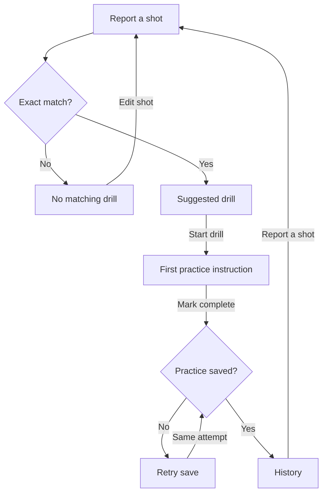
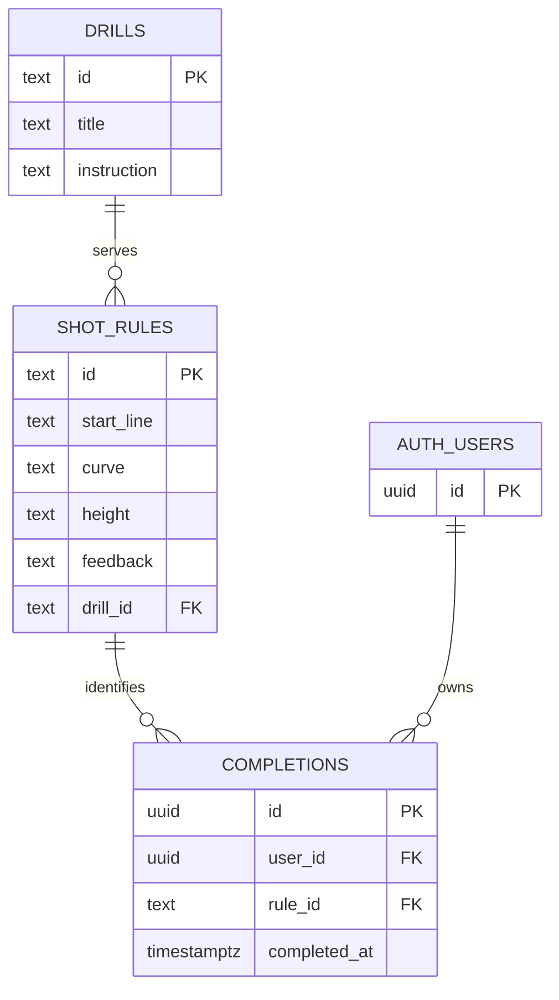

# Dial Golf Prototype

Dial Golf helps a golfer decide what to practice after a shot. Describe where the ball started, how it curved, and how high it flew. The mobile wireframe matches a supported shot to a practice drill and saves completed drills in the same browser.

The first-use goal is for a new golfer to reach the first practice instruction within **120 seconds**. The current demo has three sample drills for coach review.

## Table of contents

- [Try the prototype](#try-the-prototype)
- [Run locally](#run-locally)
- [Architecture](#architecture)
- [Flowchart](#flowchart)
- [Features and UI design](#features-and-ui-design)
- [Database ERD](#database-erd)
- [REST API endpoints](#rest-api-endpoints)
- [Two-day MVP](#two-day-mvp)

## Try the prototype

[Open the mobile wireframe](https://dial-golf-mobile-wireframe.acuteforge8.chatgpt.site) · Access is restricted to approved viewers.

1. Under **Report a shot**, select **Right** for start line, **Straight** for curve, and **Normal** for height. Tap **Find my drill**.
2. Open **Start-line check** by tapping **Start drill**. The first instruction asks you to pick a visible target and call the starting direction of your next shot.
3. Tap **Mark complete**. History shows the drill and completion time. Reload the page to see the saved entry again.

To try the other branch, enter **Left / Left / High**. Dial displays **No matching drill**. Tap **Edit shot** to return with all three selections intact.

## Run locally

From the wireframe source directory containing `dist/`, serve the static files with Python 3.7 or newer.

```sh
python3 -m http.server 8000 --bind 127.0.0.1 --directory dist
```

On the same computer, open [the local wireframe](http://127.0.0.1:8000/). The hosted preview and the local server each keep their own practice history.

## Architecture

| Layer        | Working browser wireframe                                                                                                       | Proposed mobile MVP                                                                                           |
| ------------ | ------------------------------------------------------------------------------------------------------------------------------- | ------------------------------------------------------------------------------------------------------------- |
| Presentation | `dist/index.html`, `styles.css`, and `drawings.js` render the shot controls, flight diagram, and drill screens.                 | Expo, React Native, and TypeScript for the same golfer journey.                                               |
| Application  | `dist/app.js` handles navigation and practice attempts. `dist/dial-core.js` validates the three inputs and finds an exact rule. | The app looks up a seeded rule, shows its drill, and carries a single attempt ID through save retries.        |
| Data         | Three rules ship with the JavaScript. `localStorage` holds one record per completed attempt.                                    | Supabase Auth supplies the guest identity. PostgreSQL holds the catalog, rules, and each guest’s completions. |

The browser wireframe handles matching and saving locally. The database and API below describe the proposed mobile build. Integration estimates depend on the existing Dial app’s stack.

## Flowchart



## Features and UI design

| Screen or state      | What the golfer sees and can do                                                                                                     |
| -------------------- | ----------------------------------------------------------------------------------------------------------------------------------- |
| Report a shot        | Select all three values to enable **Find my drill**. The diagram updates as the shot changes. A sample picker can prefill the form. |
| Suggested drill      | See the flight summary, feedback, and drill title. Choose **Start drill** or **Edit shot**.                                         |
| Practice in progress | Read one instruction for the next ball. **Mark complete** saves this attempt. A failed write offers **Retry save**.                 |
| No matching drill    | Review the unmatched shot, edit the selections, or try a sample.                                                                    |
| History              | See completed drills grouped by day, newest first. Starting a drill adds no entry until the golfer marks it complete.               |

### Sample shot rules

Start line is the ball’s initial direction relative to the intended target. Curve is how it bends afterward. Height is relative to the golfer’s usual shot. The three choices for each input yield 27 combinations. Three have sample rules, and the other 24 open the unmatched state.

| Start line | Curve    | Height | Result                                             |
| ---------- | -------- | ------ | -------------------------------------------------- |
| Right      | Straight | Normal | Start-line check (`r01`)                           |
| Straight   | Right    | Normal | Curve check (`r02`)                                |
| Straight   | Straight | Low    | Height check (`r03`)                               |
| Left       | Left     | High   | No matching drill, an example of an uncovered shot |

## Database ERD

The proposed PostgreSQL model links a practice attempt to the rule that selected its drill. `AUTH_USERS` represents Supabase’s `auth.users`. The other three entities are application tables in the `public` schema.



- `UNIQUE (start_line, curve, height)` makes each supported shot match one rule.
- **Start drill** creates an attempt UUID. A save retry reuses it. A new practice gets a new UUID, even for the same drill.
- The server supplies `user_id` and `completed_at`. Row-level security lets guests read the catalog and read or insert their own completions.

## REST API endpoints

Proposed Supabase contract. Restore the guest with `supabase.auth.getSession()`. If there is no session, call `supabase.auth.signInAnonymously()`. Data requests use the guest session.

| Method | Endpoint                              | Behavior                                                                                                                                                             |
| ------ | ------------------------------------- | -------------------------------------------------------------------------------------------------------------------------------------------------------------------- |
| `GET`  | `/rest/v1/shot_rules`                 | Filter by `start_line`, `curve`, and `height`. Return the matching rule with its drill. `200` with `[]` opens the unmatched state. A request failure offers a retry. |
| `POST` | `/rest/v1/completions?on_conflict=id` | Send `id` and `rule_id` with `Prefer: resolution=ignore-duplicates,return=minimal`. A retry with the same ID preserves the original completion.                      |
| `GET`  | `/rest/v1/completions`                | Fetch the guest’s completions with drill titles. Use `order=completed_at.desc,id.desc`. A new guest gets an empty list.                                              |

### Look up a drill

```http
GET /rest/v1/shot_rules?start_line=eq.right&curve=eq.straight&height=eq.normal&select=id,feedback,drills(id,title,instruction)
```

Example response for **Right / Straight / Normal** in the proposed schema.

```json
[
  {
    "id": "r01",
    "feedback": "Your shot started right and stayed on that line.",
    "drills": {
      "id": "D01",
      "title": "Start-line check",
      "instruction": "Pick a visible target and call the starting direction of your next shot."
    }
  }
]
```

### Save a completion

Example request body after **Mark complete**.

```json
{
  "id": "4f255564-c38e-4ee5-8c65-727cb0d94053",
  "rule_id": "r01"
}
```

## Two-day MVP

The estimate covers two after-work sessions of **2–3 hours each** for a standalone mobile prototype.

| Session | Deliverable                                                                          | Acceptance check                                                                                                                                                           |
| ------- | ------------------------------------------------------------------------------------ | -------------------------------------------------------------------------------------------------------------------------------------------------------------------------- |
| Day 1   | Run the manual diagnostic on a phone with three sample rules and an unmatched state. | Verify all three matches and one miss. Time an unfamiliar tester from first launch to the first instruction on a supported shot. Target **≤120 seconds** without UI hints. |
| Day 2   | Add guest sessions, database-backed completion, and History.                         | Finish a drill, retry the same save, and reopen the app. The guest sees one record. A second guest sees an empty history.                                                  |

Practice streaks and a first-practice badge are stretch goals. Pilot work includes coach-approved mappings, progress rewards, reminders, and integration with the existing app. Automatic ball-flight detection has its own feasibility study and estimate.
